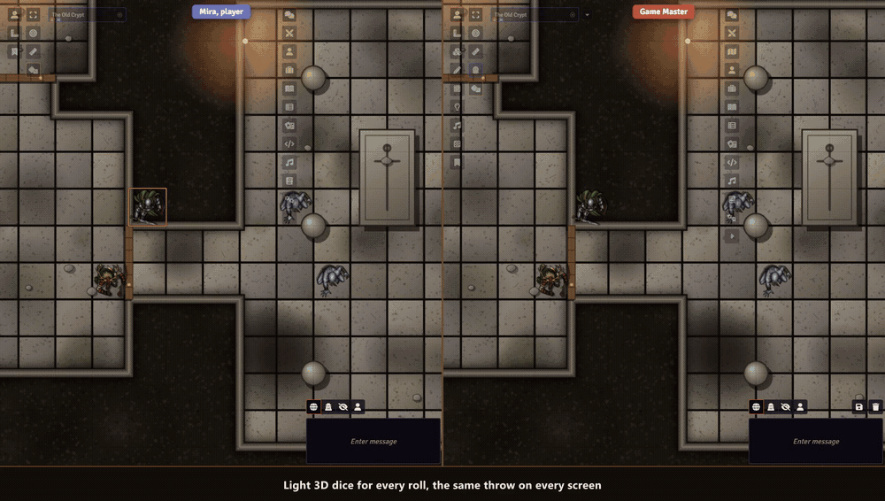
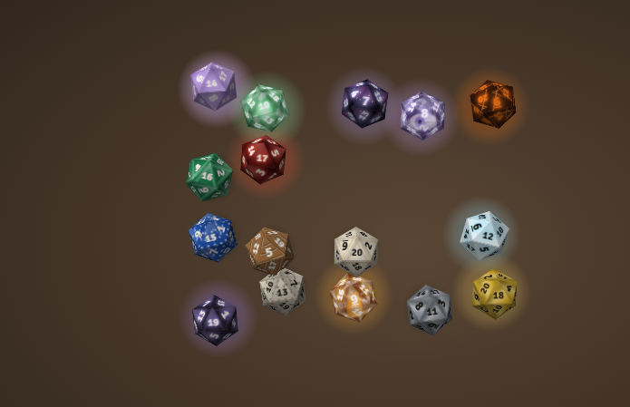

# Sephral’s Swift Dice

**The rogue rolls for the backstab and everyone leans in. Then the laptop of one player stutters, the chat card shows up late or not at all, and the moment is gone. Swift Dice throws light 3D dice for every roll that never hold up the game.**

## Highlights

* **The result never gets lost:** the chat card appears at once and shows its result when the dice lie still. Every screen sees the same throw, so nobody gives the result away early.
* **Your color, your dice:** dice take each player's Foundry color. *My dice* offers materials from glass to lava, patterns, a color for every effect and thirty ready looks.
* **Dice for every class:** the druid's dice ride a gust of wind, the paladin's wear wings, the barbarian's make the table quake. Seventeen class looks, or dice that follow the class of whoever rolls.
* **Thirteen ways to throw:** from a hand, a cup, a cannon or a bow, through a portal, as meteors and more, clicking in the sound of their material if you like.
* **Light and magic:** trails of sparks, runes or bats, auras from a halo to tentacles, landings in holy light or a shower of arrows, glass dice with a beating heart inside.
* **Big moments that fit your game:** not every game counts a 20 as good. The game system decides what a triumph is, from a D&D critical range to 01 in Call of Cthulhu, or the GM sets a rule.
* **Light enough for every table:** no WebGL, no physics engine. The dice run on old laptops, tablets and in Firefox, beside the chat.
* **Secret rolls stay secret:** blind rolls show covered dice to the one who rolled, private rolls nothing to the others. Every die from d4 to d100, any system, Midi QOL and Ready Set Roll.

## How it works

1. Enable the module. Every roll now throws dice in the color of its player.
2. Click the dice button in the token controls on the left to give your dice a look of your own, or the look of your class.
3. As GM, pick in the settings how fast the dice roll and which rolls they show.

## Good to know

Swift Dice stays off while Dice So Nice is active, so nobody sees two sets of dice.

## Install

Search for **Swift Dice** in Foundry's module browser or open the [package page](https://foundryvtt.com/packages/sephrals-swift-dice).

Foundry VTT 13 and 14 · any game system · English and German

## Learn more

Every setting, the window *My dice* and the macro API are explained in the [manual](MANUAL.md). Questions or ideas? Join us on [Discord](https://discord.gg/7BjCgDYaBP). Looking for more? See [all modules by Sephral](https://github.com/Sephral).

## License

See [LICENSE.md](LICENSE.md).
